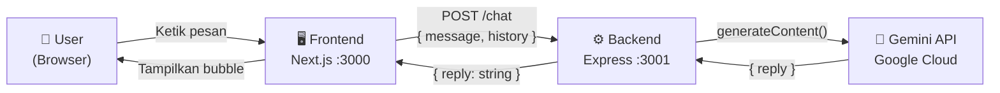
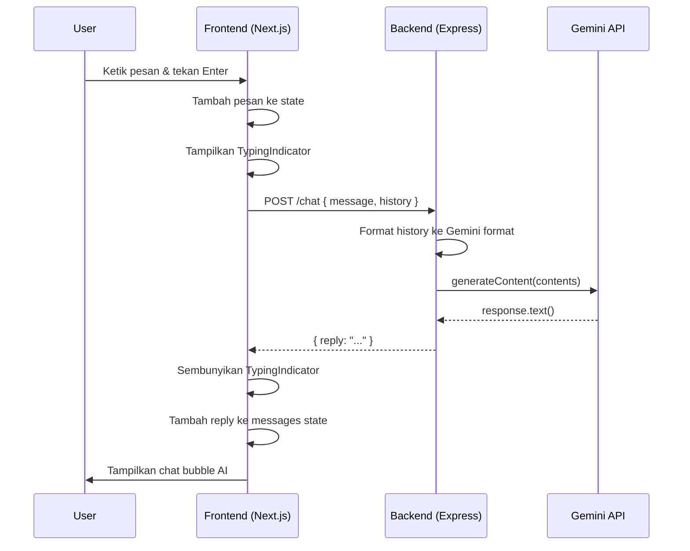
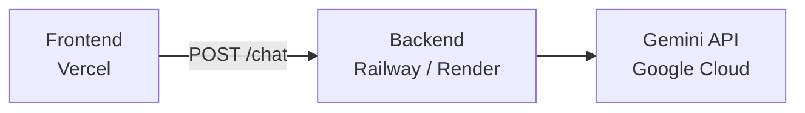
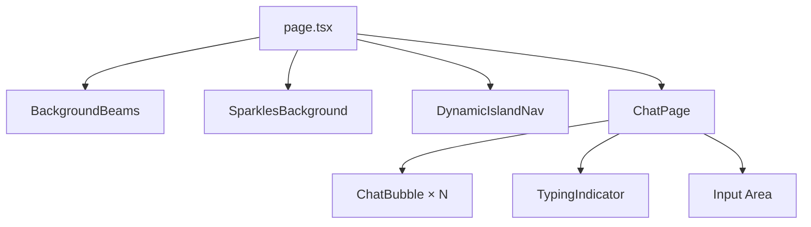

# 📄 Dokumen Teknis — AI Chatbot Website

> Versi: 1.0.0 · Tanggal: 17 November 2026 · Status: Draft

---

## 1. Ringkasan Proyek

**AI Chatbot** adalah aplikasi web full-stack yang memungkinkan pengguna berkomunikasi dengan AI berbasis Google Gemini melalui antarmuka chat modern bergaya dark mode. Proyek ini terdiri dari dua layanan terpisah yang berjalan secara bersamaan:

| Layanan | Teknologi | Port |
|---------|-----------|------|
| Frontend | Next.js 14 App Router | `3000` |
| Backend | Node.js + Express | `3001` |
| AI Engine | Google Gemini API | — (cloud) |

---

## 2. Arsitektur Sistem



### Alur Data



---

## 3. Struktur Proyek

```
📁 bagong/                          ← Root workspace
├── 📁 frontend/                    ← Next.js App
│   ├── 📁 app/
│   │   ├── page.tsx               ← 🎯 Halaman utama (SATU FILE LENGKAP)
│   │   ├── layout.tsx             ← Root layout
│   │   └── globals.css            ← Global styles
│   ├── package.json
│   ├── tailwind.config.ts
│   ├── tsconfig.json
│   └── next.config.ts
│
└── 📁 backend/                     ← Express Server
    ├── server.js                  ← 🎯 Entry point backend
    ├── .env                       ← GEMINI_API_KEY (jangan di-commit!)
    ├── .gitignore
    └── package.json
```

---

## 4. Frontend — Next.js

### 4.1 Tech Stack

| Package | Versi | Fungsi |
|---------|-------|--------|
| `next` | 14.x | Framework React App Router |
| `react` | 18.x | UI library |
| `typescript` | 5.x | Type safety |
| `tailwindcss` | 3.x | Utility-first CSS |
| `framer-motion` | 11.x | Animasi (Dynamic Island, chat bubbles) |
| `lucide-react` | latest | Icon library |

### 4.2 Komponen dalam `page.tsx`

Semua komponen ditulis **inline dalam satu file** sesuai requirement:

```
page.tsx
├── BackgroundBeams        ← Efek beam SVG (Aceternity-inspired)
├── SparklesBackground     ← Partikel ambient (CSS animation)
├── DynamicIslandNav       ← Floating nav pill (ShitUI-inspired)
├── TypingIndicator        ← Bouncing dots loading state
├── ChatBubble             ← Animated message bubble
└── ChatPage               ← Main component (default export)
    ├── State management
    ├── API fetch logic
    ├── Auto-scroll logic
    └── JSX render tree
```

### 4.3 State Management

```typescript
// Tipe data pesan
interface Message {
  id: string;           // nanoid / crypto.randomUUID()
  role: "user" | "assistant";
  content: string;
  timestamp: Date;
}

// State utama di ChatPage
const [messages, setMessages]   = useState<Message[]>([]);
const [input, setInput]         = useState<string>("");
const [isLoading, setIsLoading] = useState<boolean>(false);
const [error, setError]         = useState<string | null>(null);
const messagesEndRef             = useRef<HTMLDivElement>(null);
```

### 4.4 API Call

```typescript
// POST ke backend
const response = await fetch("http://localhost:3001/chat", {
  method: "POST",
  headers: { "Content-Type": "application/json" },
  body: JSON.stringify({
    message: input.trim(),
    history: messages.map(m => ({
      role: m.role,
      content: m.content
    }))
  })
});

// Response yang diharapkan dari backend
const data: { reply: string } = await response.json();
```

### 4.5 Komponen Visual Detail

#### `DynamicIslandNav` (ShitUI-inspired)

```
Collapsed state  → pill kecil 220×48px, tampilkan nama app + status dot
Hover/expanded   → spring morph ke 420×64px, tampilkan navigasi lengkap
Animasi          → Framer Motion spring { stiffness: 400, damping: 30 }
layoutId pill    → "active-pill" untuk smooth tab switching
```

#### `BackgroundBeams` (Aceternity-inspired)

```
SVG paths       → 10+ garis diagonal dengan gradient
Mask            → radial-gradient ellipse di tengah
Animasi         → CSS strokeDashoffset animation, durasi 4–8s
Color           → indigo-500/30 → violet-500/20 → transparent
```

#### `ChatBubble`

```
User bubble     → kanan, bg: linear-gradient(blue-600→indigo-600)
AI bubble       → kiri, bg: neutral-900/80 + border neutral-800
Entry animation → { opacity: 0, y: 15, scale: 0.95 } → { 1, 0, 1 }
Shimmer border  → animasi gradient border khusus untuk AI bubble
Avatar          → Ikon Bot (AI) / User (Lucide)
Timestamp       → format HH:mm, text-xs muted
```

#### `TypingIndicator`

```
3 dots          → animate-bounce dengan delay -300ms, -150ms, 0ms
Container       → sama styling dengan AI bubble
AnimatePresence → fade in saat loading, fade out saat selesai
```

### 4.6 Fitur Interaksi

| Fitur | Detail |
|-------|--------|
| **Kirim pesan** | Klik tombol Send atau tekan `Enter` |
| **Newline** | `Shift + Enter` |
| **Hapus chat** | Tombol Trash2 → konfirmasi → `setMessages([])` |
| **Auto-scroll** | `useEffect` trigger `scrollIntoView({ behavior: "smooth" })` setiap `messages` berubah |
| **Error state** | Toast notif merah jika fetch gagal, auto-dismiss 4 detik |
| **Empty state** | Welcome screen animasi saat belum ada pesan |

### 4.7 Responsivitas

| Breakpoint | Layout |
|------------|--------|
| `< 640px` (mobile) | Full-width, padding 16px, font-size dikurangi |
| `640–1024px` (tablet) | Max-width 2xl, padding 24px |
| `> 1024px` (desktop) | Max-width 4xl, centered, padding 32px |

---

## 5. Backend — Node.js + Express

### 5.1 Tech Stack

| Package | Versi | Fungsi |
|---------|-------|--------|
| `express` | 4.x | HTTP server |
| `@google/generative-ai` | latest | Gemini SDK |
| `cors` | 2.x | Cross-origin requests |
| `dotenv` | 16.x | Environment variables |

### 5.2 Struktur `server.js`

```javascript
// server.js — Entry point
import express from "express";
import cors from "cors";
import { GoogleGenerativeAI } from "@google/generative-ai";
import dotenv from "dotenv";

dotenv.config();

const app  = express();
const genAI = new GoogleGenerativeAI(process.env.GEMINI_API_KEY);
const model = genAI.getGenerativeModel({ model: "gemini-2.0-flash" });

app.use(cors({ origin: "http://localhost:3000" }));
app.use(express.json());

// POST /chat
app.post("/chat", async (req, res) => { ... });

app.listen(3001);
```

### 5.3 Endpoint `POST /chat`

**Request Body:**
```json
{
  "message": "Halo, siapa kamu?",
  "history": [
    { "role": "user",      "content": "Halo" },
    { "role": "assistant", "content": "Halo! Ada yang bisa saya bantu?" }
  ]
}
```

**Response Body (sukses):**
```json
{
  "reply": "Saya adalah AI assistant yang ditenagai oleh Google Gemini..."
}
```

**Response Body (error):**
```json
{
  "error": "Gagal menghubungi Gemini API"
}
```

### 5.4 Format History ke Gemini

Gemini SDK menggunakan format `contents[]` dengan role `"user"` / `"model"`:

```javascript
const contents = [
  ...history.map(msg => ({
    role: msg.role === "assistant" ? "model" : "user",
    parts: [{ text: msg.content }]
  })),
  {
    role: "user",
    parts: [{ text: message }]
  }
];

const result = await model.generateContent({ contents });
const reply  = result.response.text();
```

> [!NOTE]
> Role `"assistant"` dari frontend dikonversi ke `"model"` untuk Gemini API. Ini adalah mapping wajib karena Gemini hanya mengenal role `"user"` dan `"model"`.

### 5.5 System Prompt (Opsional)

```javascript
const model = genAI.getGenerativeModel({
  model: "gemini-2.0-flash",
  systemInstruction: "Kamu adalah asisten AI yang ramah dan membantu. Jawab dalam Bahasa Indonesia kecuali user bertanya dalam bahasa lain."
});
```

### 5.6 Environment Variables

File `.env` di folder `backend/`:

```env
GEMINI_API_KEY=AIza...your_key_here
PORT=3001
```

> [!CAUTION]
> Jangan pernah commit file `.env` ke Git. Pastikan `.gitignore` sudah include `.env`.

---

## 6. Setup & Instalasi

### 6.1 Prerequisites

- Node.js ≥ 18.x
- npm ≥ 9.x
- Google AI Studio account (untuk API key Gemini)

### 6.2 Langkah Setup

```bash
# 1. Clone atau buat folder proyek
mkdir bagong && cd bagong

# 2. Setup Frontend
npx create-next-app@latest frontend \
  --typescript --tailwind --app --src-dir=no --import-alias="@/*"
cd frontend
npm install framer-motion lucide-react
cd ..

# 3. Setup Backend
mkdir backend && cd backend
npm init -y
npm install express @google/generative-ai cors dotenv
# Tambahkan "type": "module" di package.json
cd ..
```

### 6.3 Jalankan Development

```bash
# Terminal 1 — Backend
cd backend
node server.js
# → Server berjalan di http://localhost:3001

# Terminal 2 — Frontend
cd frontend
npm run dev
# → App tersedia di http://localhost:3000
```

---

## 7. Keamanan

| Aspek | Implementasi |
|-------|-------------|
| **API Key** | Disimpan di `.env`, tidak di-expose ke frontend |
| **CORS** | Dibatasi hanya ke `http://localhost:3000` |
| **Input validation** | Backend cek `message` tidak kosong |
| **Rate limiting** | (Opsional) `express-rate-limit` untuk production |
| **HTTPS** | Wajib di production (Vercel/Railway handle otomatis) |

---

## 8. Deployment (Production)



| Layanan | Platform Rekomendasi | Environment Var |
|---------|---------------------|-----------------|
| Frontend | Vercel (free) | `NEXT_PUBLIC_API_URL=https://your-backend.railway.app` |
| Backend | Railway / Render (free tier) | `GEMINI_API_KEY=...`, `PORT=3001` |

> [!IMPORTANT]
> Saat production, ganti `http://localhost:3001` di frontend dengan URL backend production via environment variable `NEXT_PUBLIC_API_URL`.

---

## 9. Diagram Komponen



---

## 10. Referensi

| Resource | URL |
|----------|-----|
| ShitUI Dynamic Island Nav | https://shitui.in/docs/components/dynamic-island-nav |
| Aceternity UI Components | https://ui.aceternity.com/components |
| Google Gemini SDK (Node.js) | https://ai.google.dev/gemini-api/docs/quickstart?lang=node |
| Framer Motion | https://www.framer.com/motion |
| Lucide React Icons | https://lucide.dev/icons |
| Next.js App Router | https://nextjs.org/docs/app |
